# Retail Sales & Profit Performance Dashboard

**Power BI · SQL · Python · DAX**

An end-to-end retail analytics project: a three-year, eight-store dataset modelled on how a
big-box store runs, a SQL layer with data quality checks and KPI queries, and a four-page
Power BI report covering sales, profit margin, year-over-year growth, plan attainment, store
productivity and the customer service desk.

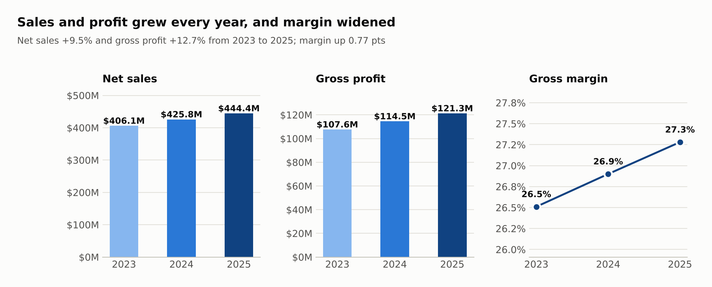

---

## Why I built this

I've worked at Walmart Canada since February 2024 on the customer service desk and in
consumables. I've covered every department, including receiving, and spent time as a
temporary department supervisor. On the floor you see the patterns before you see the
numbers: the Saturday rush, the January return lines, the growing number of calls about
online pickup and delivery orders.

I wanted to build the dashboard I'd want as a department manager: one that shows whether we
are growing, whether we are making more profit on each dollar of sales than last year, where
markdowns and returns are eating margin, and whether we are staffed for the days customers
actually shop.

> **About the data:** the dataset is simulated. I wrote a Python generator
> (`scripts/generate_data.py`) whose rules come from what I've seen working in a store:
> department mix, seasonality, holiday spikes, clearance markdowns, returns, online growth
> and service desk contacts. **No real Walmart data is used**, and the store names are
> generic city locations, not real stores. Everything is reproducible from a fixed random seed.

---

## Business questions

1. How did net sales, gross profit and gross margin change from 2023 to 2025?
2. Which departments drive profit, and where are markdowns and returns hurting margin?
3. How fast are online pickup and delivery growing, and what do they do to margin?
4. Which stores beat their sales plan, and is a miss a one-off or a trend?
5. Are labour hours scheduled for the days customers shop?
6. Why do customers contact the service desk, and which contacts are hardest to resolve?

---

## Key insights

### 1. Profit grew faster than sales, because markdowns came down

| | 2023 | 2024 | 2025 |
| --- | --- | --- | --- |
| Net sales | $406.1M | $425.8M | $444.4M |
| Sales growth vs last year | | +4.9% | +4.4% |
| Gross profit | $107.6M | $114.5M | $121.3M |
| Gross margin | 26.5% | 26.9% | 27.3% |
| Markdown rate (share of ticket price) | 4.0% | 3.6% | 3.3% |

Net sales rose 9.5% over two years while gross profit rose 12.7%. The difference is margin,
which widened 0.77 points. About 0.43 points of that came from lower markdowns (down from
4.0% to 3.3% of ticket sales) and about 0.30 points from lower product costs; the small remainder
is department and channel mix. Every month of 2025 beat the same month of 2024, and every month of 2024
beat 2023.

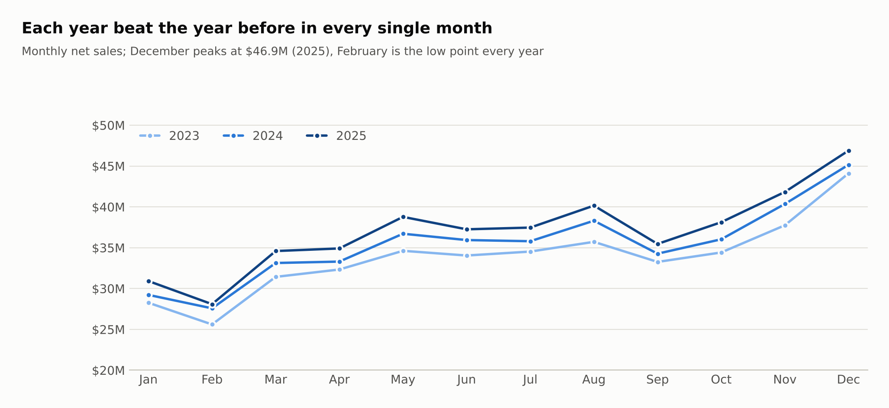

### 2. Electronics drives sales but little profit; the margin is in Health & Beauty, Home and Apparel

- **Electronics** is 11.1% of 2025 sales but only 5.5% of gross profit (13.4% margin), and
  6.3% of its sales come back as returns. It grew just 1.4% in two years.
- **Health & Beauty** grew fastest (+18.3% since 2023) at a 35.2% margin.
- **Apparel** has the highest margin (40.9%) and the highest return rate (7.3%).
- **Grocery** is the biggest department (24.2% of sales), but its margin stayed flat at
  21.7% while every other department improved.

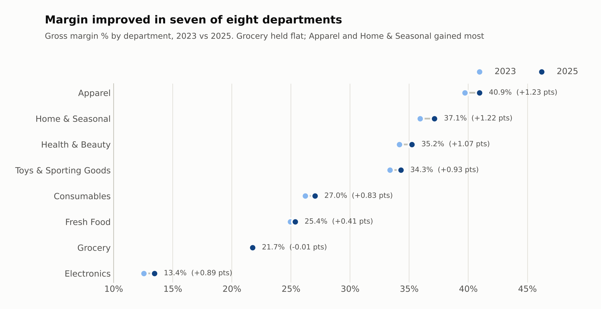

### 3. January is the most expensive month for margin

In general merchandise, January's clearance markdown rate is 9.7% and its return rate is
9.6%, roughly double the spring months. Total gross margin drops to 25.3% in January
compared with 27.7% in May.

### 4. Online is now 18% of sales, at a lower margin

Online pickup and delivery grew from 12.4% of sales in 2023 to 18.1% in 2025. Delivery
orders earn a 25.1% margin versus 27.6% in store (picking and delivery cost) and have a
higher return rate (3.1% vs 2.3%).

| Channel share of sales | 2023 | 2024 | 2025 |
| --- | --- | --- | --- |
| In-Store | 87.6% | 84.8% | 81.9% |
| Online Pickup | 8.0% | 9.8% | 11.6% |
| Online Delivery | 4.4% | 5.4% | 6.5% |

Black Friday sells 1.7 to 1.8 times a normal November Friday; Boxing Day about 1.3 times a
normal December day.

### 5. Two stores need attention: Prince Albert and Yorkton

The chain finished 2025 at 99.9% of plan, but only two of eight stores reached 100%.
**Saskatoon South** grew 9.2% and beat plan by $2.86M (104.5%). **Prince Albert** grew only
1.6%, finished at 97.2% of plan ($1.29M short) and was below plan in all 12 months of 2025,
so this is a trend, not a bad month. **Yorkton** was below plan in 11 of 12 months.

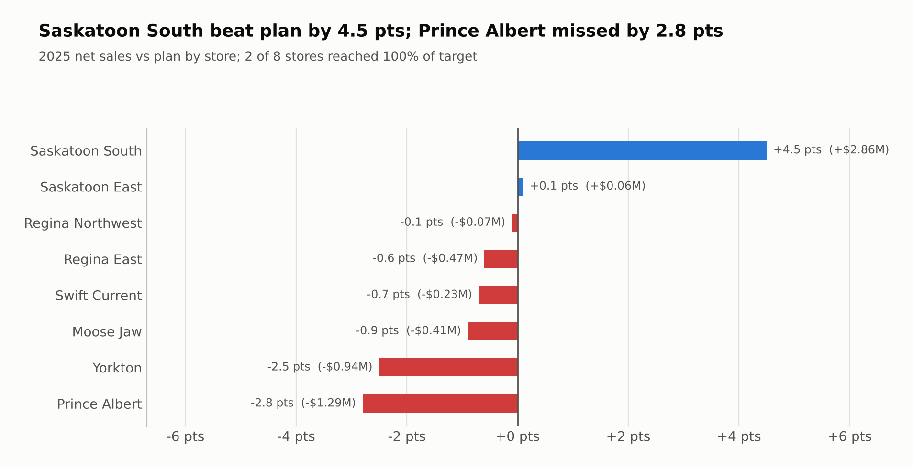

### 6. Saturdays are understaffed relative to sales

On Saturdays, average store sales are 48% higher than on Tuesdays, but scheduled labour
hours are only 13% higher. That pushes sales per labour hour to $186 on Saturday versus
$141 on Tuesday. In store terms, the weekend team is stretched thinnest when the store is
busiest.

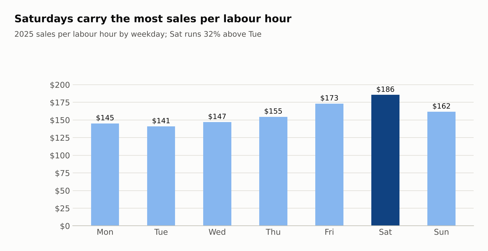

### 7. Online order contacts are now the desk's #1 reason, and the hardest to resolve

Service desk contacts rose to 140,320 in 2025. Contacts about online orders and delivery grew
43% since 2023 and overtook product availability as the top reason. They have the lowest
first-contact resolution (67.8% vs 85.8% for product availability) and the longest handle
time (9.3 minutes). Chat grew from 17.3% to 22.7% of contacts, taking share from the phone.

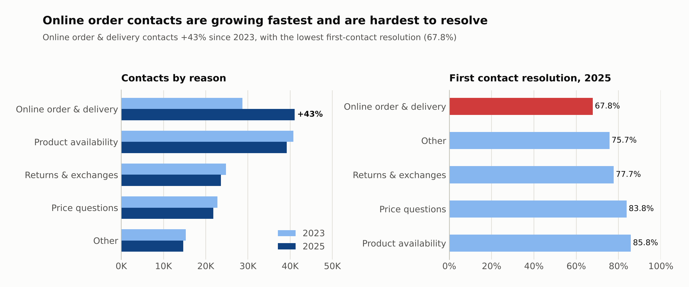

---

## Recommendations

1. **Move labour hours from Tuesday and Wednesday into Friday and Saturday**, starting with
   checkouts, the service desk and online pickup, where weekend demand is highest.
2. **Give the service desk better online order tools**, such as order-status lookup and a
   short guide for the most common delivery questions. Online orders are now the largest and
   slowest contact reason, and raising its first-contact resolution would have the biggest
   effect on desk workload.
3. **Keep tightening January clearance.** Lower markdowns already added most of the margin
   gain; buying seasonal general merchandise closer to demand would shrink the January dip.
4. **Review Prince Albert and Yorkton** with their store managers: whether the plan matches
   local demand, and what is happening to traffic and basket size.
5. **Watch online fulfilment cost.** Delivery margin is 2.5 points below in-store, and online
   keeps growing. Pickup is the cheaper online option to promote.

---

## Power BI report

Four pages, built on the model below. The report is stored as a **Power BI Project**
([`powerbi/Retail_Sales_Profit_Dashboard.pbip`](powerbi/Retail_Sales_Profit_Dashboard.pbip)),
Microsoft's text-based format for Power BI files, so the model, measures and pages are
readable and versioned in Git. Open it in Power BI Desktop and refresh; the steps are in
[`powerbi/BUILD_GUIDE.md`](powerbi/BUILD_GUIDE.md), which also covers building the report
by hand. All measures are in [`powerbi/measures.dax`](powerbi/measures.dax), and
`scripts/build_pbip.py` generates the project from that file, so the DAX is defined once.

| Page | What it shows |
| --- | --- |
| **Executive Overview** | Net sales, gross profit and margin with year-over-year change, sales vs plan, channel mix |
| **Departments** | Margin, markdown and return rates by department, with conditional formatting; January clearance spike |
| **Stores** | Store scorecard, plan attainment by store and sales per labour hour by weekday |
| **Service Desk** | Contacts by reason and channel, first-contact resolution, handle time, online order trend |

### Screenshots

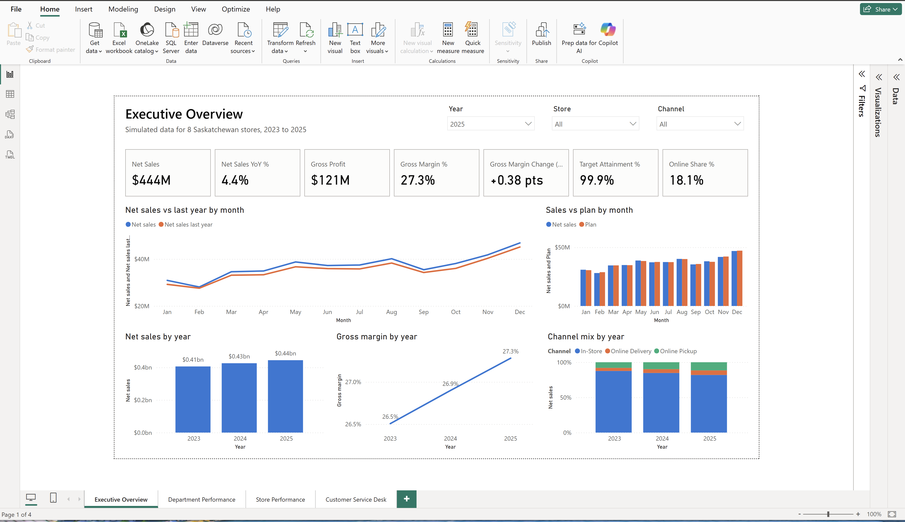
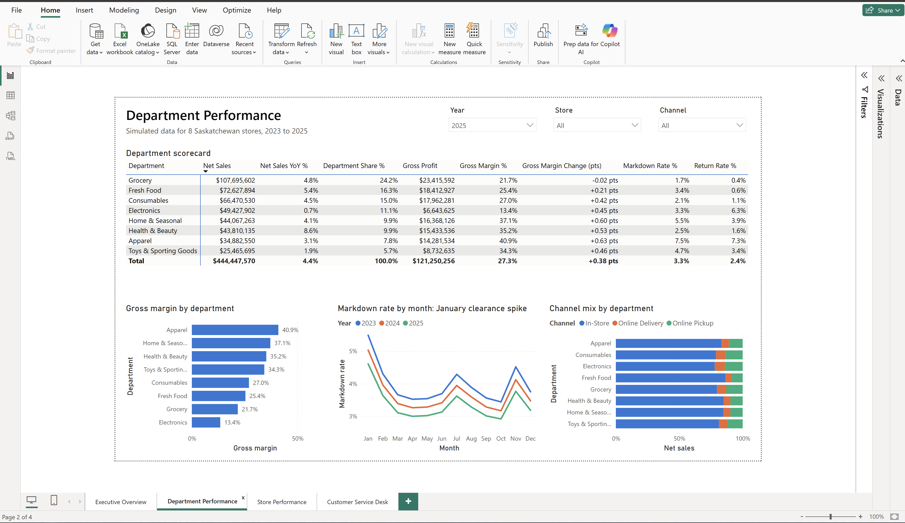
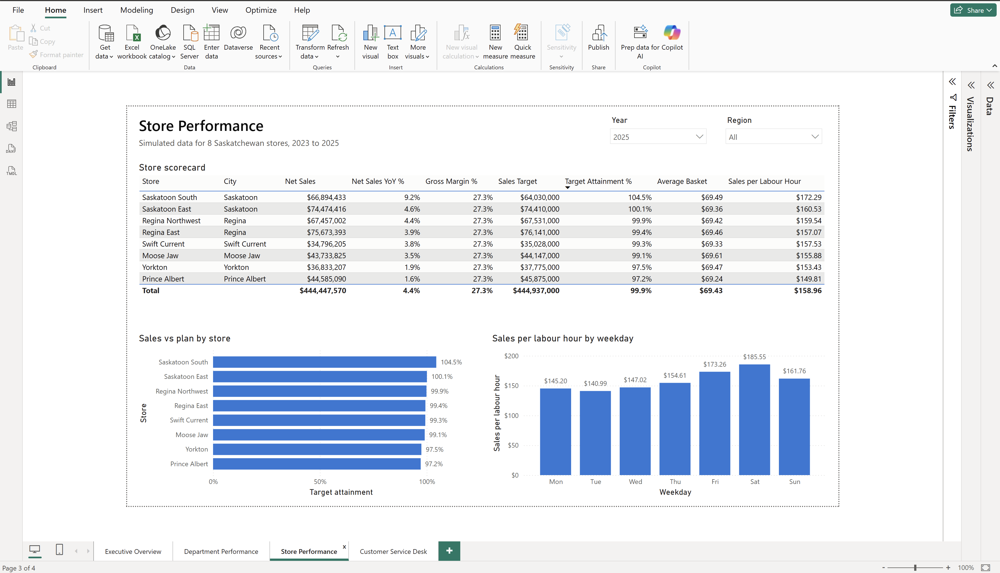
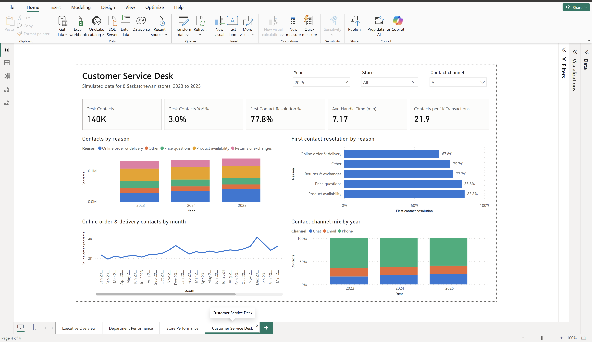

Files: [Retail_Sales_Profit_Dashboard.pbix](powerbi/Retail_Sales_Profit_Dashboard.pbix) ·
[PDF export](powerbi/Retail_Sales_Profit_Dashboard.pdf)

**DAX highlights:** time intelligence (`SAMEPERIODLASTYEAR`, `TOTALYTD`, `DATEADD`),
margin change in percentage points, plan attainment that ignores department and channel
filters (targets are set per store), `RANKX` store ranking, and text measures for
"▲ 4.4% vs last year" card labels and conditional formatting colours.

---

## Data model

A star schema with four dimensions and four fact tables at different grains.

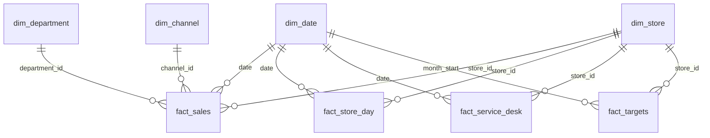

| Table | Grain | Rows |
| --- | --- | --- |
| `fact_sales` | day x store x department x channel | 209,856 |
| `fact_service_desk` | day x store x contact channel x reason | 131,160 |
| `fact_store_day` | day x store (transactions, labour hours) | 8,744 |
| `fact_targets` | month x store (sales plan) | 288 |
| `dim_date` | one row per day, 2023-01-01 to 2025-12-31 | 1,096 |
| `dim_store` | 8 Saskatchewan store locations | 8 |
| `dim_department` | 8 departments in 3 groups | 8 |
| `dim_channel` | In-Store, Online Pickup, Online Delivery | 3 |

Column definitions and the simulation rules are in
[`docs/data_dictionary.md`](docs/data_dictionary.md).

---

## SQL

- [`sql/01_schema.sql`](sql/01_schema.sql): tables, primary and foreign keys, indexes
- [`sql/02_data_quality_checks.sql`](sql/02_data_quality_checks.sql): 10 checks (no negative
  amounts, net = gross - markdowns, profit = net - COGS, complete daily grid, no orphan keys,
  one target per store-month, and more). The build stops if any check fails.
- [`sql/03_kpi_analysis.sql`](sql/03_kpi_analysis.sql): 12 analysis queries using CTEs,
  window functions (`LAG`, `SUM() OVER`), conditional aggregation and multi-fact joins

All results are saved in [`outputs/analysis_results.md`](outputs/analysis_results.md).
They double as the answer key for the Power BI measures
([`powerbi/expected_values.md`](powerbi/expected_values.md)).

---

## Project structure

```
retail-sales-profit-dashboard/
├── data/                     CSV files (dimensions and facts)
├── docs/
│   └── data_dictionary.md    columns, grain and simulation rules
├── images/                   README charts (Power BI screenshots go in images/powerbi/)
├── outputs/                  SQL results as CSV and markdown
├── powerbi/
│   ├── Retail_Sales_Profit_Dashboard.pbip            open this in Power BI Desktop
│   ├── Retail_Sales_Profit_Dashboard.SemanticModel/  data model (TMDL)
│   ├── Retail_Sales_Profit_Dashboard.Report/         report pages (PBIR)
│   ├── BUILD_GUIDE.md        open the project, or build the report by hand
│   ├── measures.dax          all DAX measures
│   ├── theme.json            report colour theme
│   └── expected_values.md    numbers the report should show
├── scripts/
│   ├── generate_data.py      builds the dataset
│   ├── build_database.py     loads SQLite, runs checks and analysis
│   ├── make_charts.py        draws the README charts
│   └── build_pbip.py         generates the Power BI Project from measures.dax
├── sql/
│   ├── 01_schema.sql
│   ├── 02_data_quality_checks.sql
│   └── 03_kpi_analysis.sql
├── LICENSE
├── requirements.txt
└── README.md
```

---

## How to run

Requires Python 3.10 or newer.

```bash
git clone https://github.com/manthanray03/retail-sales-profit-dashboard.git
cd retail-sales-profit-dashboard

python3 -m venv .venv
source .venv/bin/activate          # Windows: .venv\Scripts\activate
pip install -r requirements.txt

python scripts/generate_data.py    # writes data/*.csv
python scripts/build_database.py   # builds retail.db, runs checks and SQL analysis
python scripts/make_charts.py      # redraws images/*.png
python scripts/build_pbip.py       # regenerates the Power BI Project (only if you change measures.dax)
```

The CSV files are already in `data/`, so you can skip straight to Power BI. The committed
CSVs are the reference copy; a different NumPy version can shift the random draws slightly
if you regenerate.

---

## Tools and skills

**Power BI:** star schema modelling, relationships, date table, DAX measures and time
intelligence, edit interactions, synced slicers, Power BI Projects (PBIP, TMDL, PBIR) in Git
**SQL (SQLite):** schema design, constraints, CTEs, window functions, data quality testing
**Python:** pandas, NumPy, matplotlib, reproducible data generation
**Retail analytics:** gross margin, markdown and return rates, plan attainment, average
basket, sales per labour hour, first-contact resolution

---

## Author

**Manthan Ray** · Regina, Saskatchewan
[LinkedIn](https://www.linkedin.com/in/manthanray) · [GitHub](https://github.com/manthanray03)
